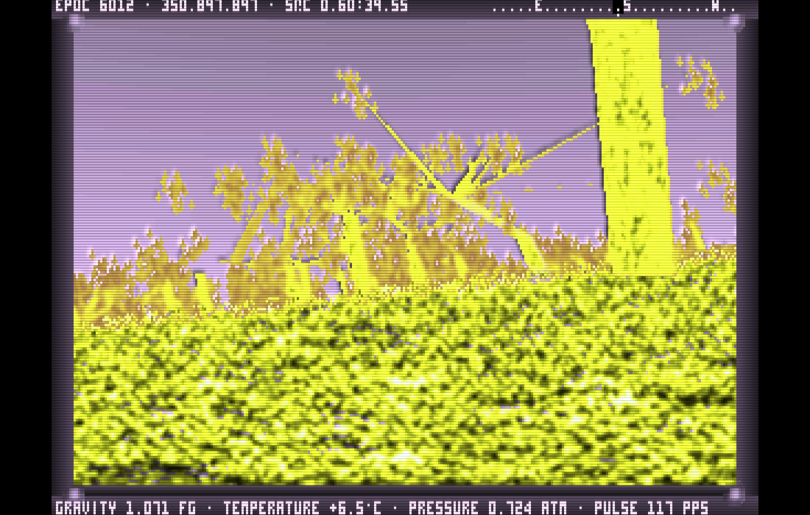

# Noctis IV Plus для Linux (SDL2 + OpenGL)

Нативный порт **Noctis IV Plus r2.3** (модификация космического симулятора
Noctis IV Алессандро Гиньолы) на Linux. Игра больше не требует DOSBox:
16-битный код Borland C++ 3.1 с ассемблерными вставками переписан на
переносимый C++17, а вывод, клавиатура, мышь и таймер работают через SDL2.
Кадр выводится через OpenGL с масштабированием и фильтрами на GPU.



## Какую версию взяли за основу и почему

Были сравнены два дистрибутива:

| | **NICE r11.6a** (Noctis IV CE, «Cryoburner Edition») | **Noctis IV Plus r2.3** |
|---|---|---|
| Исходники | **нет** — только готовые `.exe` | **полные** исходники (Borland C++ 3.1, `NOCTIS.CPP`, `NOCTIS-0.CPP`, `NOCTIS-1.CPP`, `TDPOLYGS.H`, модули GOES) |
| Платформа | DOS `noctis*.exe` + незаконченный Win32 `DWNoctis.exe`, лаунчеры `Go!.exe` | DOS |
| Звёздная карта и гид | старые форматы `starmap2`/`starmap3` | новее: `STARMAP.BIN` / `GUIDE.BIN` от 2023-10 |
| Уникальные функции | температура, летающий посадочный модуль, обозреватель системы на F2, ИК-режим против тумана, режимы обзора космоса, HacIRC, SyncStarmap, доп. модули (fndplnt, importgd, rscan, prif и др.) | джетпак и прыжок, mouselook (3 режима), съёмка видео (moviemaker), омега-драйв (отрицательный заряд), roofspeed (`S`), сглаживание на `TAB`, экран справки на `F1`, нумерация снимков как в NICE |

NIV+ уже включает большую часть полезных функций NICE (они были
перенесены авторами NIV+), а главное — только у NIV+ есть исходный код.
Портировать игру без исходников можно только через эмуляцию, поэтому
основой стала NIV+. Функции, которые есть только в бинарниках NICE
(температура, летающий модуль, F2-обозреватель, HacIRC и т. д.), в порт
не вошли: восстанавливать их пришлось бы дизассемблированием.

## Что сделано в порте

* **Весь движок переведён с ассемблера на C++** (около 70 % исходного кода
  было inline-asm): полигоны, текстурирование, звёзды, планеты, облака,
  поверхность, растительность, животные, эффекты свечения и т. д. Рендер
  остаётся программным и 8-битным (320×200, палитра), как в оригинале,
  поэтому картинка совпадает с DOS-версией.
* **Вселенная та же, что в DOS-версии.** Повторены генератор случайных
  чисел Borland, правила приведения float→int (через x87 `FISTP`), порядок
  вычисления аргументов (справа налево) и 16-битное переполнение. Поэтому
  звёзды, планеты и метки из `STARMAP.BIN`/`GUIDE.BIN` находятся там же.
* **OpenGL-вывод**: палитра переводится в RGBA, кадр масштабируется на
  GPU шейдером GLSL. Фильтры: `nearest`, `sharp` (резкий билинейный, по
  умолчанию), `linear`, `crt` (сканлайны). Есть растяжение до 4:3,
  полноэкранный режим и vsync. Если OpenGL недоступен, используется
  программный рендер SDL (`--software`).
* **Модули GOES Net** (CAT, ST, SL, DL, PAR, WHERE, CLEAN, CAST, REP, DELE,
  PRI, INBOX, OUTBOX) встроены в игру и запускаются без DOS. HELP, REPAIR,
  WRI и TXT, исходники которых не распространялись, написаны заново по
  описанию.
* **Сохранения** (`CURRENT.BIN`, `SURFACE.BIN`) записываются побайтно в
  раскладке DOS-версии, а не дампом структур x86-64.
* Пути DOS (`..\DATA\STARMAP.BIN`) открываются без учёта регистра.
  Снимки сохраняются в `gallery/`, кадры видео — в `movies/`.

## Сборка

Зависимости: компилятор C++17 (GCC или Clang), CMake ≥ 3.13, SDL2,
OpenGL.

```sh
# Debian / Ubuntu
sudo apt install build-essential cmake pkg-config libsdl2-dev libgl-dev
# Fedora
sudo dnf install gcc-c++ cmake SDL2-devel mesa-libGL-devel
# Arch
sudo pacman -S base-devel cmake sdl2 mesa

cmake -S . -B build
cmake --build build -j
./build/noctis
```

Игру можно запускать прямо из дерева исходников: каталог `data/`
находится рядом с `build/`.

Установка в систему:

```sh
sudo cmake --install build        # /usr/local/bin/noctis, /usr/local/share/noctis-iv-plus
```

Установленная копия при первом запуске переносит данные в
`~/.local/share/noctis-iv-plus/`, если системный каталог недоступен для
записи. Там же хранятся сохранения, снимки и звёздная карта с вашими
метками. Каталог игры можно задать переменной `NOCTIS_DATA=/путь`.

Параметр CMake `-DNOCTIS_X87_MATH=OFF` отключает x87-арифметику (на не-x86
она отключается сама). Игра будет работать, но отдельные процедурные
детали могут чуть отличаться от DOS-версии.

## Запуск

```
noctis [--fullscreen | --window] [--scale N] [--filter nearest|sharp|linear|crt]
       [--no-vsync] [--software] [--square-pixels] [--mouse-sens X] [--no-grab]
```

### Клавиши порта

| Клавиша | Действие |
|---|---|
| `Alt+Enter` | полноэкранный режим / окно |
| `F11` | следующий фильтр (nearest → sharp → linear → crt) |
| `F12` | захватить мышь / освободить |
| закрыть окно | выход с сохранением (как `Esc` в оригинале) |

### Управление игрой (как в оригинале)

Мышь поворачивает взгляд и перемещает пилота. Левый клик выбирает пункт,
двойной правый клик подтверждает цель или переводит взгляд на консоль.
Бортовым компьютером можно управлять и с клавиатуры:

* `5` — управление полётом, `R` — бортовые устройства, `D` — настройки,
  `X` — выключить дисплей; `6`–`9` — пункты подменю.
* `56` — дальняя цель, `57` — полёт Vimana, `58` — ближняя цель (планета),
  `59` — посадочная капсула (выбор точки стрелками, `Enter` — посадка).
* `M`/`*` — снимок, `B` — «сырой» снимок, `F3` — запись видео,
  `TAB` — сглаживание, `S` — roofspeed, `F1` — справка.
* На поверхности: `0`–`9` — скорость, `J` — прыжок, `Пробел` — джетпак,
  `C` — отпустить управление джетпаком, `L` — приземлиться, `↑` — mouselook.

Полное руководство лежит в [`manual/noctis_iv_manual.html`](manual/noctis_iv_manual.html),
горячие клавиши — в [`manual/shortcuts.html`](manual/shortcuts.html),
история изменений NIV+ — в [`docs/NIVPLUS_CHANGES.TXT`](docs/NIVPLUS_CHANGES.TXT).

## Структура

```
src/dos/        эмуляция DOS/BIOS/Borland: память far-heap, файлы, rand, таймер 18.2 Гц, клавиатура, мышь
src/platform/   SDL2 + OpenGL: окно, шейдеры, палитра, ввод
src/game/       игра (NOCTIS.CPP, NOCTIS-0.CPP, NOCTIS-1.CPP, TDPOLYGS.H на C++)
src/goes/       модули GOES Net
data/           звёздная карта, гид и модели (из NIV+ r2.3)
manual/         руководство
```

Для отладки без экрана есть переменные окружения
`NOCTIS_FRAMEDUMP=<каталог>` (сохранять кадры в PPM) и `NOCTIS_SCRIPT`
(подавать ввод по таймеру), см. `src/platform/platform_sdl.cpp`.

## Лицензия

Noctis IV © 1996–2002 Alessandro Ghignola, распространяется под
WTOF Public License: см. [`WPL.HTM`](WPL.HTM). Noctis IV Plus — Mega,
Neuzd, SL и другие участники сообщества. Код порта распространяется на тех
же условиях.
